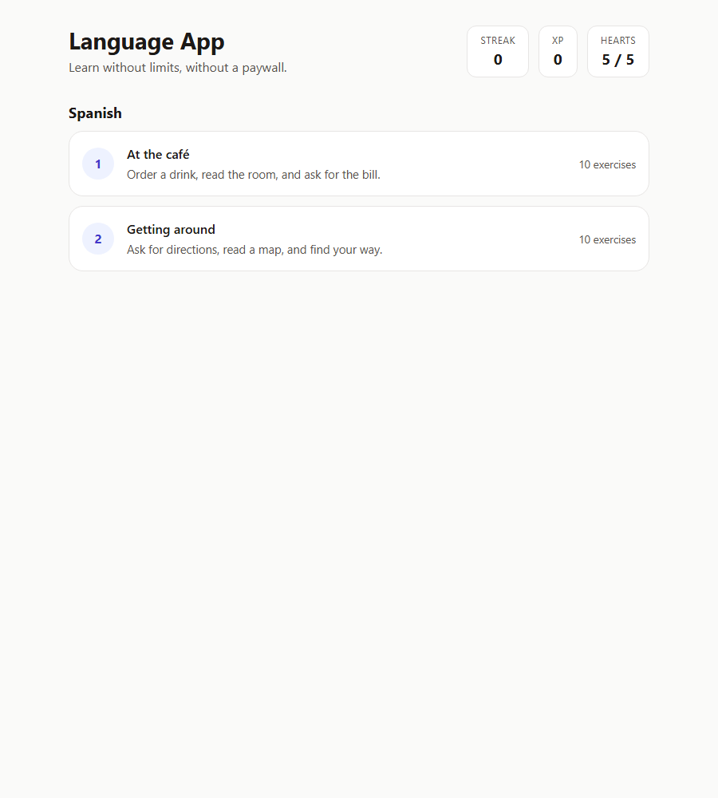
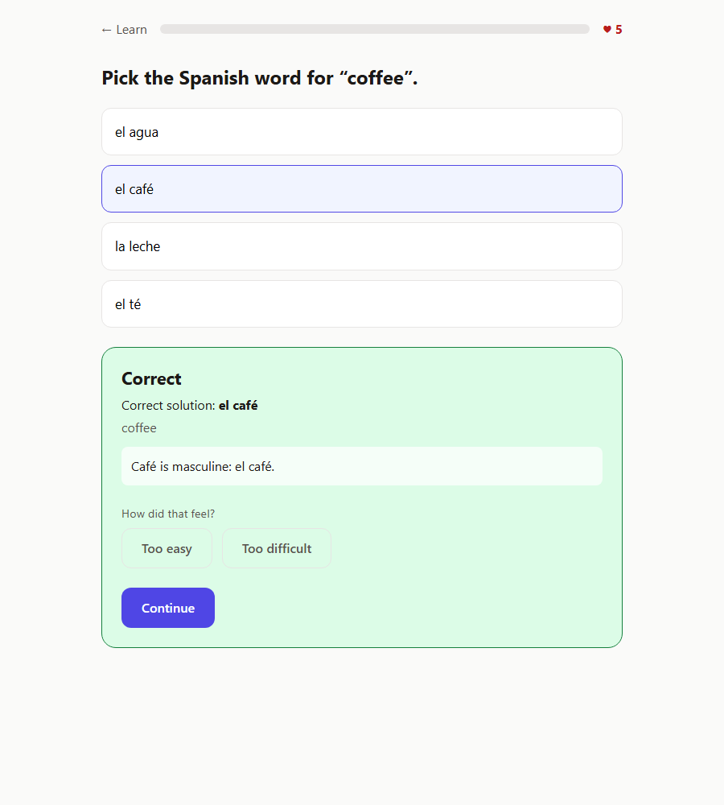
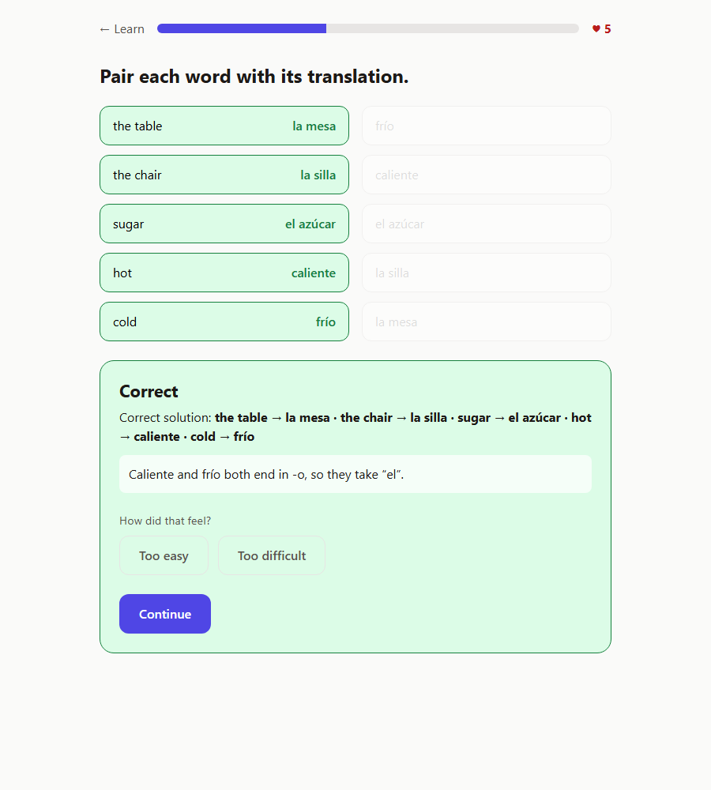
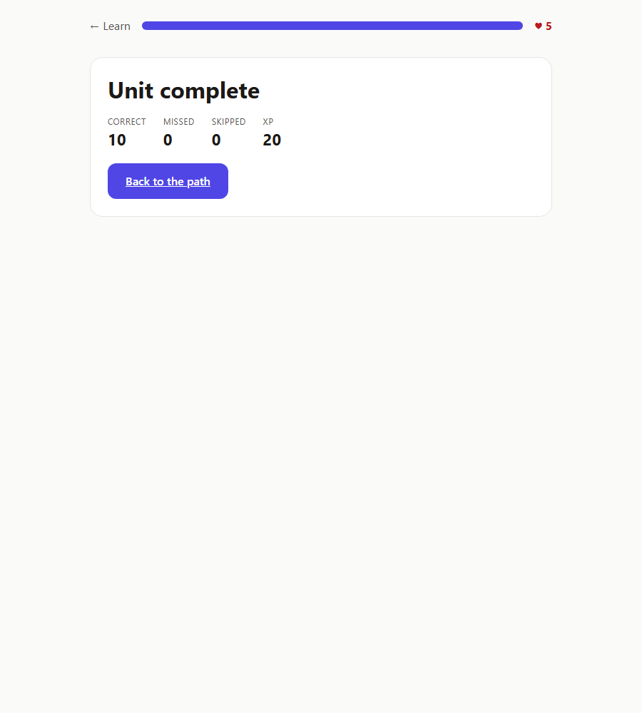

# Language App

Our own language-learning app. We studied how the reference app's method works —
the gamified loop, spaced repetition, streaks, leagues, hearts, XP — and
re-implement the *mechanics* with our own content and no paywall.

- **Design:** [`docs/design/lesson-engine.md`](docs/design/lesson-engine.md)
- **Observations of the reference app:** [`docs/rea/findings-ledger.md`](docs/rea/findings-ledger.md)
  (every finding cites a REA evidence id)
- **Working rules:** [`AGENTS.md`](AGENTS.md)

## Track priority

1. **Spanish** (from English) — in progress
2. German (from English)
3. English

## Run it

```bash
npm install
cp .env.example .env      # then paste your Postgres URL into .env
npm run dev               # http://localhost:3000
```

`.env` holds `DATABASE_URL` and is gitignored. The schema is created on first use;
`npm run migrate` applies the same file from the command line.

Verify a change:

```bash
npm run build && npm test
npm run test:db           # the same tests against the real database
```

`npm test` includes the two content gates: the path audit (no unit uses a
grammar point before it is taught) and the content check (no stray
characters, and no word taught twice in one level). Both also run on their
own: `npm run audit:path` and `npm run check:content`.

Boot check: `node .output/server/index.mjs`, then `GET /api/health` → `{"status":"ok"}`.

## Adding content

**The words are the content; the exercises are built from them.**

1. Write `content/<track>/<LEVEL>/unit-N.vocab.json` — ten words, each with a
   translation, an article and a note.
2. `npm run build:content` regenerates `unit-N.json` (ten exercises, four shapes).
3. `npm test` fails if the two ever drift.

Two rules the generator and the tests enforce:

- **A wrong answer is always a word the learner has already met.** Same theme
  first. A distractor they have never seen is a new word wearing a disguise.
- **A unit teaches one thing**: one grammar point, one theme, ten words.

## How it fits together

```
shared/content/schema.ts   exercise + unit schema (zod), one union, three tracks
shared/srs/types.ts        outcomes and self-grades, shared by app and server

server/domain/srs/         the SRS engine: mastery, schedule, selection, economy
                           pure TypeScript, no Nuxt, no browser, fully unit tested
server/domain/exercise/    grading (accent/case insensitive) and the client view
server/domain/progress/    the repository seam, plus an in-memory implementation
server/db/                 the Postgres client, the schema, the repository
server/services/           content, learner state, lesson sessions
server/api/                tracks · units · progress · session · answer · complete

content/es/track.json      the A1 to B2 ladder
content/es/A1/unit-N.json  exercise content, validated at build time
app/components/exercises/  one component per exercise type + a renderer registry
app/components/lesson/     the feedback panel
app/pages/                 dashboard · lesson/[track]/[level]/[unit]
```

### The two rules that matter

1. **The server owns the answer key.** The client never receives `answer`,
   `translation` or `note` before the learner answers. Grading happens in
   `server/domain/exercise/grading.ts`, which folds accents, case and punctuation
   so `Café.` is accepted for `el café`.
2. **The learner grades the item, not just the answer.** Every item ends with
   *Too easy* / *Too difficult*. That self-grade is the signal the SRS engine
   learns from; correctness is only the second signal.

## Screens

| | |
| --- | --- |
|  |  |
|  |  |

## Current state

Working: the A0 to B2 ladder (95 units, 950 words, every unit with a lesson
and drills), the dashboard with the learner's place in it, the lesson player
(select / match / type_in / listen), server-side grading, the self-grade
feedback panel, the SRS engine, XP, streak, progress that survives a restart
(Postgres), the practice loop that brings due and shaky items back, unit
unlocking along a gapless path, and the revisit path: a unit answered badly
is weak, and weak units are offered back on the dashboard.

Not built yet: recorded audio for the `listen` type, German and English
content, and the levels above A1 are still thin on vocabulary.
